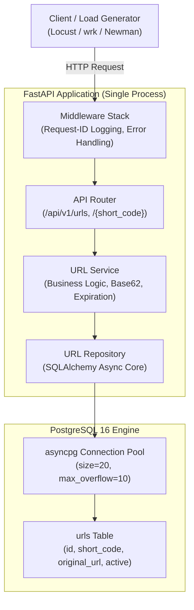
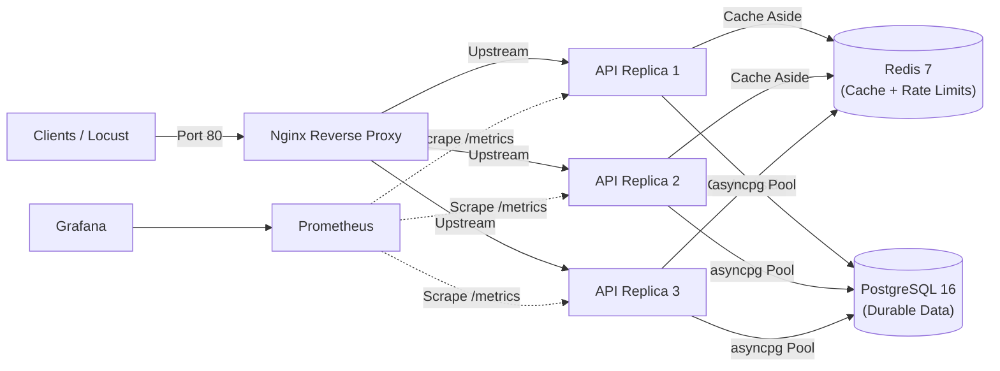

# Shortify — System Architecture Specification

**Specification:** `Shortify_Project_1_Engineering_Roadmap.pdf`  
**Governing Standard:** `AGENTS.md`  
**Architectural Stage:** Phase 1 Baseline Architecture

---

## 1. Architectural Philosophy: The Clean Baseline

A foundational requirement of the Shortify engineering laboratory is:
> *"Do not add Redis yet. The intentionally simple architecture gives you a clean baseline. Never claim an optimization, scale limit, or performance improvement until you have measured a baseline, recorded the test conditions, identified the bottleneck, changed one variable, and reproduced the result."*

Therefore, the system is architected in distinct evolutionary tiers:
1. **Tier 1 (Phases 0–6 Baseline):** Pure FastAPI + PostgreSQL relational persistence.
2. **Tier 2 (Phases 7–9 Optimized Storage & Caching):** B-Tree indexes, connection pool tuning, and Redis Cache-Aside.
3. **Tier 3 (Phases 10–12 Observability & Horizontal Scaling):** Prometheus/Grafana instrumentation and Nginx load-balanced replicas.

---

## 2. Baseline Architecture (Phases 0–6)



### Component Responsibilities

1. **Client / Load Generator:**
   - Initiates HTTP requests (`POST /api/v1/urls`, `GET /{short_code}`, `GET /health`).
   - Acts as load generator during benchmarking (Locust, wrk).

2. **Middleware Stack:**
   - **Correlation ID Middleware:** Assigns a unique `X-Request-ID` to every incoming request and injects it into structured log contexts.
   - **Central Exception Handler:** Intercepts unhandled exceptions, ensures zero leak of database stack traces, and formats standardized JSON error responses.

3. **API Router Layer (`app/api/`):**
   - Pure HTTP layer: deserializes JSON, handles FastAPI dependency injection (`get_db`, `get_url_service`), and returns typed response models.

4. **Service Layer (`app/services/`):**
   - Enforces core domain rules: validates original URLs against SSRF/malformed patterns, executes Base62 short-code generation with collision retry backoff, checks expiration timestamps, and manages soft deletion.

5. **Repository Layer (`app/repositories/`):**
   - Isolates all database operations: executes atomic click count increments (`UPDATE urls SET click_count = click_count + 1 WHERE ...`), manages transactions, and executes clean queries.

6. **Durable Persistence (`PostgreSQL 16`):**
   - Managed via SQLAlchemy 2.0 async and `asyncpg` connection pool. Enforces database-level unique constraint on `short_code`.

---

## 3. Data Flow Workflows

### 3.1 Short URL Creation Flow
```
Client ──► POST /api/v1/urls ──► URL Service
                                   │ 1. Validate original URL (scheme, length, syntax)
                                   │ 2. Check custom alias or generate Base62 code
                                   ▼
                             URL Repository ──► PostgreSQL
                                                 │ INSERT INTO urls ...
                                                 ▼
                             Response 201 Created ◄── Return URL entity
```

### 3.2 High-Throughput Redirection Flow
```
Client ──► GET /{short_code} ──► Redirect Endpoint
                                    │ 1. Query short_code from URL Repository
                                    ▼
                              PostgreSQL
                                    │ SELECT original_url, expires_at, active FROM urls...
                                    ▼
                              Validation: active == true && expires_at > NOW()
                                    │
                                    ├─ If invalid ──► Return 404 Not Found / 410 Gone
                                    └─ If valid   ──► Atomic increment click_count
                                                      Return HTTP 307 (Location: target)
```

---

## 4. Future Architecture Evolution (Phases 8–12)


